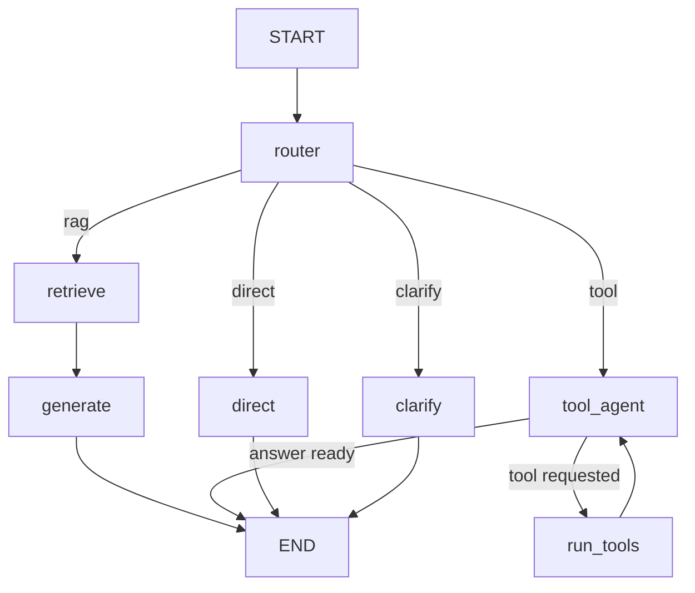

# Agentic AI Customer Support Assistant

One AI customer support assistant that serves **many businesses** from a single app. Each business has its own name and branding, knowledge-base documents, search index, customers, orders, tickets and (optionally) its own OpenAI key, and no business can ever see another's data. For every message, a LangGraph agent decides whether to answer from that business's knowledge base (RAG), call a tool (order status, support tickets, cancellations), reply conversationally, or ask the customer for missing information.

Two demo businesses are included: **NovaCart** (an online shop) and **GreenLeaf Grocery** (grocery delivery). New businesses are added on the **Admin** page by uploading their documents and data.

> **Demo project.** The businesses, customers, orders and tickets are simulated in a local SQLite database. There is no real e-commerce backend, no real customer data, and no external integration other than the OpenAI API.

## Overview

| | |
|---|---|
| **LLM** | OpenAI (`gpt-5.4-mini` by default) through `langchain-openai` |
| **Orchestration** | LangGraph state graph with a router node |
| **RAG** | Local text documents → chunks → embeddings → FAISS → grounded answer |
| **Tools** | `get_order_status`, `get_customer_details`, `create_support_ticket`, `cancel_order` |
| **Multi-business** | SQLite database keyed by `business_id`, one FAISS index per business |
| **UI** | Streamlit chat (one link per business) with a debug panel, plus an Admin page |

## Problem Statement

Support teams answer the same policy questions repeatedly, while other requests need account data or an action. A plain chatbot either makes up policy details or can't touch order data. A support assistant needs to know **when** to look something up, **when** to act, and **when** to ask for missing details instead of guessing.

## Solution

A small agent workflow that first classifies the request, then sends it to the right branch:

| Route | Example | What happens |
|---|---|---|
| RAG | "What is your refund policy?" | FAISS search over policy documents → answer grounded in retrieved text |
| Tool | "Where is order ORD1001?" | LLM calls `get_order_status(order_id="ORD1001")` → natural answer from the result |
| Direct | "Hello" | Short conversational reply |
| Clarify | "Where is my order?" | Asks for the order ID instead of calling a tool |

## Multi-Business Design

Every business is identified by a **business ID** such as `novacart` or `greenleaf`. The ID comes from the app (the sidebar picker or the link `/?business=greenleaf`), never from the LLM, and it travels through the whole request:

```
link ?business=greenleaf
   -> app.py picks the business, starts a fresh chat for it
   -> run_turn(message, history, business_id, customer_id)
   -> LangGraph state["business_id"]
        router / answers   prompts filled with GreenLeaf's name and description
        retrieve           searches vector_store/greenleaf/ only
        run_tools          execute_tool(..., business_id) -> SQL "WHERE business_id = ?"
        get_llm            GreenLeaf's own OpenAI key if set, else the .env key
```

| What | Where each business's copy lives |
|---|---|
| Settings and branding | `businesses` table (name, description, logo emoji, accent colour, currency, optional API key) |
| Knowledge base | `documents` table, one row per uploaded file |
| Search index | `vector_store/<business_id>/` (a separate FAISS index) |
| Customers, orders, tickets | `customers`, `orders`, `tickets` tables, all with a `business_id` column |

**How data stays separate**

1. Every table has a `business_id` column, and every query in `src/db.py` filters on it. The same customer ID (`CUST001`) can exist in two businesses as two different people.
2. Each business has its own FAISS index, so a search can only return that business's text.
3. `business_id` is not in any tool schema, so the LLM cannot see or choose it. `execute_tool` drops any `business_id` the LLM sends and uses the session's value.
4. Switching business in the chat starts a new conversation, so one business's chat history is never sent to the LLM as another's.
5. `tests/test_multi_business.py` checks all of this without an API key.

**Admin page** (`pages/1_Admin.py`, opened from the sidebar): add a business, upload `.txt`/`.md` documents (the search index rebuilds automatically), import customers and orders as JSON, view tickets, edit branding, set a business's own OpenAI key, or delete a business. Set `ADMIN_PASSWORD` in `.env` to protect it.

## Key Features

- One app for many businesses, with strict data separation and per-business branding
- Admin page to add businesses and upload their knowledge base, customers and orders
- Intelligent routing between RAG, tool calling, direct reply and clarification
- Grounded answers: the RAG prompt only allows information from retrieved policy chunks
- Genuine LLM tool calling (the model chooses the tool and its arguments)
- Safeguards: arguments are validated in code, the business ID and signed-in customer ID come from the app and override the LLM, customers can only see or cancel their own orders, tool errors become helpful messages, and a loop limit stops runaway tool calls
- Multi-turn conversations ("Where is my order?" → "ORD1001" continues the request)
- Debug mode that shows safe execution metadata: route, search query, sources, tool name, tool input and tool result. It never shows hidden reasoning.
- Friendly error messages for a missing or invalid API key, quota problems, network errors, a missing knowledge base, and tool failures

## Architecture

```
                    USER  (link: /?business=<id>)
                      |
                      v
            STREAMLIT CHAT UI (app.py)        ADMIN PAGE (pages/1_Admin.py)
                      |                              |
                      |  business_id                 v
                      |                    SQLite (data/app.db) + FAISS per business
                      |
                      v
            LANGGRAPH WORKFLOW (src/graph.py)
                      |
                      v
         ROUTER NODE (LLM + structured output)
         rag | tool | direct | clarify
      +---------+----------+-----------+
      |         |          |           |
      v         v          v           v
  retrieve  tool_agent   direct     clarify
  (FAISS)   (LLM+tools)
      |       |    ^
      v       v    |
  generate  run_tools
      |     (validate + execute)
      |       |
      +---+---+----------+-----------+
          |
          v
    FINAL RESPONSE -> USER
```

## RAG Pipeline

```
documents table (this business's uploaded files)
   -> LangChain Documents
   -> RecursiveCharacterTextSplitter (500-char chunks, 80 overlap)
   -> Embeddings (all-MiniLM-L6-v2, local; or OpenAI text-embedding-3-small)
   -> FAISS index saved in vector_store/<business_id>/
   -> similarity search (top 4 chunks)
   -> LLM answers using only those chunks
```

Each business's index is built automatically the first time it is used, after its documents change on the Admin page, and if the embedding model changes. Build all of them manually with `python -m src.rag`.

The router also rewrites follow-up questions into a standalone **search query** (for example "what about electronics?" becomes "What is the return window for electronics?") so retrieval works across turns.

## Agent Workflow



**State** (`SupportState` in `src/agent.py`):

| Field | Purpose |
|---|---|
| `messages` | Chat history for multi-turn context |
| `business_id` | Which business this chat belongs to; set by the app, used by retrieval and tools |
| `business_name`, `business_description` | Fill in the shared prompts so the assistant speaks as that business |
| `customer_id` | Signed-in customer from the sidebar; tools use it |
| `action`, `route_label` | Router decision, drives branching and debug mode |
| `search_query` | Standalone question used for FAISS search |
| `missing_info` | What the clarify node asks for |
| `retrieved_context` | Chunks returned by FAISS |
| `tool_messages` | Tool requests and results for the current turn only |
| `tool_calls` | Log of tool name, input and result for debug mode |
| `tool_rounds` | Safety counter for the tool loop |
| `final_response` | Text shown to the user |

## Tools

| Tool | Input | Does |
|---|---|---|
| `get_order_status` | `order_id` | Status, tracking and estimated delivery |
| `get_customer_details` | `customer_id` | Profile and list of orders |
| `create_support_ticket` | `customer_id`, `issue`, optional `order_id` | Saves a ticket for this business and returns its ID |
| `cancel_order` | `order_id`, `customer_id` | Cancels only if the order is `Processing` and belongs to the customer |

## Technology Stack

Python 3.12, OpenAI API, LangChain, LangGraph, FAISS, Hugging Face sentence-transformers, SQLite, Streamlit, pytest.

## Project Structure

```
agentic-ai-customer-support/
├── app.py                  Streamlit chat (pick a business or use /?business=<id>)
├── pages/
│   └── 1_Admin.py          Admin page: businesses, documents, data, tickets
├── requirements.txt
├── .env.example
├── .gitignore
├── pytest.ini
├── data/
│   ├── app.db              SQLite database (created on first run, not committed)
│   └── seed/               demo businesses loaded into an empty database
│       ├── novacart/       business.json, customers.json, orders.json, knowledge_base/
│       └── greenleaf/      same layout
├── src/
│   ├── config.py           settings and paths from .env
│   ├── db.py               SQLite tables and every query (all filtered by business_id)
│   ├── prompts.py          LLM prompts shared by all businesses
│   ├── rag.py              load, split, embed, FAISS per business, retrieve
│   ├── tools.py            simulated tools and safe execution
│   ├── agent.py            state, LLM and graph node functions
│   └── graph.py            LangGraph wiring and run_turn()
├── tests/                  pytest tests for tools, RAG and business isolation
├── docs/
│   ├── TESTING.md          manual test checklist
│   └── INTERVIEW_PREP.md   how to explain the project
└── vector_store/           generated FAISS indexes, one folder per business (not committed)
```

## Installation

Requires Python 3.11 or 3.12 on Windows, macOS or Linux. Step-by-step Windows instructions, including common errors, are in [RUN_STEPS.md](RUN_STEPS.md).

```powershell
cd agentic-ai-customer-support
python -m venv .venv
.venv\Scripts\Activate.ps1          # macOS/Linux: source .venv/bin/activate
python -m pip install --upgrade pip
pip install -r requirements.txt
```

## Environment Variables

Copy `.env.example` to `.env` and set your key:

```
OPENAI_API_KEY=sk-...
OPENAI_MODEL=gpt-5.4-mini
EMBEDDING_PROVIDER=huggingface
DEFAULT_BUSINESS_ID=novacart   # business shown first
ADMIN_PASSWORD=                # optional password for the Admin page
```

`.env` is listed in `.gitignore` and must never be committed.

## Running the Application

```powershell
python -m pytest -v                 # tool, RAG and isolation tests, no API cost
python -m src.rag                   # optional: build every business's index and run a test query
python -m streamlit run app.py      # opens http://localhost:8501
```

## Example Queries

- What is your refund policy?
- Can I return a damaged product?
- Where is order ORD1001?
- Where is my order? (then reply with `ORD1001`)
- My package arrived damaged. Create a support ticket.
- Can I cancel order ORD1003? (set Customer ID to `CUST002`)
- What payment methods do you support?
- Do you ship internationally?
- Hello

The sidebar example buttons use real order IDs from the selected business.

| Business | Link | Customers and orders |
|---|---|---|
| NovaCart | `/?business=novacart` | `CUST001` (ORD1001, ORD1002), `CUST002` (ORD1003, ORD1004), `CUST003` (ORD1005, ORD1006) |
| GreenLeaf Grocery | `/?business=greenleaf` | `CUST001` (ORD5001, ORD5002), `CUST002` (ORD5003) |

Try the same question in both businesses: "What is your refund policy?" gives NovaCart's 30-day policy in one and GreenLeaf's 48-hour perishables policy in the other, and `ORD1001` is "not found" in GreenLeaf.

## Screenshots

_Add screenshots of the chat and debug panel to a `screenshots/` folder and link them here._

## Limitations

- Orders, customers and tickets are simulated in SQLite and uploaded as JSON, not pulled live from each business's real systems.
- A business's own OpenAI key is stored in plain text in `data/app.db` (which is git-ignored). A production system would encrypt it or use a secrets manager.
- All businesses share one embedding model, chosen in `.env`.
- Documents must be `.txt` or `.md`; PDF and Word upload is not supported yet.
- One route is chosen per message. A message that mixes a policy question and an action ("what's the damage policy, and open a ticket") is handled by one branch.
- There is no authentication. The sidebar customer ID stands in for a logged-in user, and the Admin page has only an optional shared password (no per-business admin accounts).
- Chat history lives in the browser session and is lost on refresh.
- SQLite and local FAISS folders suit one server. Many busy businesses would need PostgreSQL and a hosted vector database.
- Answer quality depends on the LLM. Routing is prompt-based and can occasionally misclassify.

## Future Improvements

- Evaluate routing and RAG answers with a labelled test set (for example with RAGAS)
- Per-business admin logins, so each business manages only its own data
- Connectors that sync orders from each business's real system (Shopify, WooCommerce, a REST API)
- PDF and Word document upload
- PostgreSQL with row-level security and a hosted vector database for many businesses
- Human-in-the-loop confirmation before cancelling an order (LangGraph interrupts)
- Persistent conversation memory with a LangGraph checkpointer
- Streaming responses in the UI
- Hybrid search (keyword + vector) and reranking
