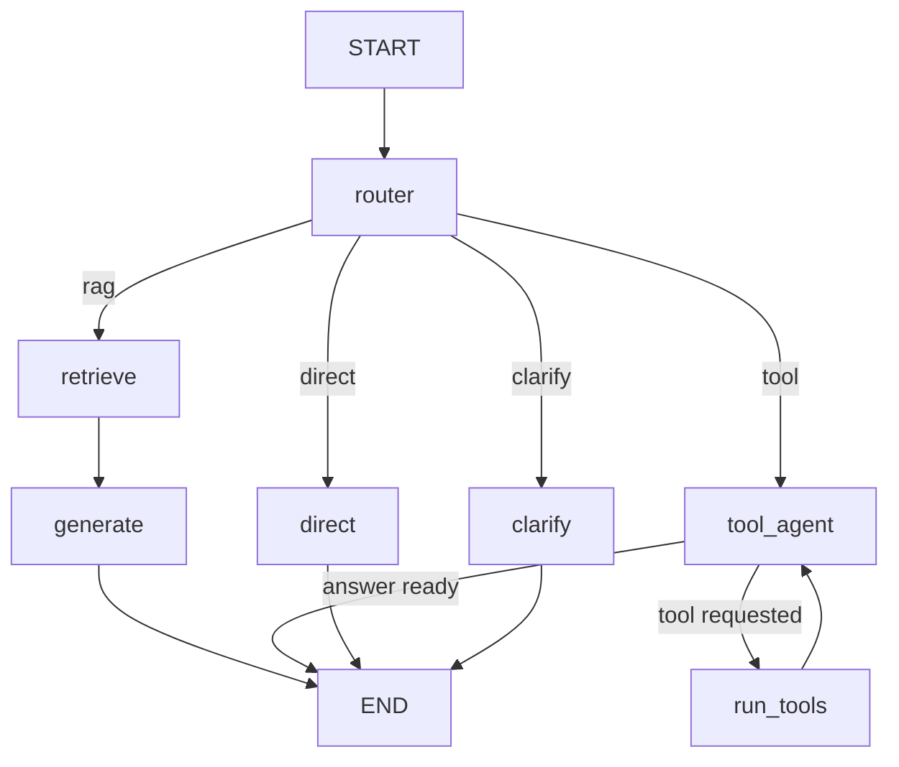

# Agentic AI Customer Support Assistant

An AI customer support assistant for **NovaCart**, a fictional e-commerce store. For every message, a LangGraph agent decides whether to answer from the policy knowledge base (RAG), call a tool (order status, support tickets, cancellations), reply conversationally, or ask the customer for missing information.

> **Demo project.** NovaCart, its customers, orders and tickets are simulated with local JSON files. There is no real e-commerce backend, no real customer data, and no external integration other than the OpenAI API.

## Overview

| | |
|---|---|
| **LLM** | OpenAI (`gpt-5.4-mini` by default) through `langchain-openai` |
| **Orchestration** | LangGraph state graph with a router node |
| **RAG** | Local text documents → chunks → embeddings → FAISS → grounded answer |
| **Tools** | `get_order_status`, `get_customer_details`, `create_support_ticket`, `cancel_order` |
| **UI** | Streamlit chat with an optional debug panel |

## Problem Statement

Support teams answer the same policy questions repeatedly, while other requests need account data or an action. A plain chatbot either makes up policy details or can't touch order data. A support assistant needs to know **when** to look something up, **when** to act, and **when** to ask for missing details instead of guessing.

## Solution

A small agent workflow that first classifies the request, then sends it to the right branch:

| Route | Example | What happens |
|---|---|---|
| RAG | "What is your refund policy?" | FAISS search over policy documents → answer grounded in retrieved text |
| Tool | "Where is order ORD1001?" | LLM calls `get_order_status(order_id="ORD1001")` → natural answer from the result |
| Direct | "Hello" | Short conversational reply |
| Clarify | "Where is my order?" | Asks for the order ID instead of calling a tool |

## Key Features

- Intelligent routing between RAG, tool calling, direct reply and clarification
- Grounded answers: the RAG prompt only allows information from retrieved policy chunks
- Genuine LLM tool calling (the model chooses the tool and its arguments)
- Safeguards: arguments are validated in code, the signed-in customer ID overrides the LLM, customers can only see or cancel their own orders, tool errors become helpful messages, and a loop limit stops runaway tool calls
- Multi-turn conversations ("Where is my order?" → "ORD1001" continues the request)
- Debug mode that shows safe execution metadata: route, search query, sources, tool name, tool input and tool result. It never shows hidden reasoning.
- Friendly error messages for a missing or invalid API key, quota problems, network errors, a missing knowledge base, and tool failures

## Architecture

```
                    USER
                      |
                      v
            STREAMLIT CHAT UI (app.py)
                      |
                      v
            LANGGRAPH WORKFLOW (src/graph.py)
                      |
                      v
         ROUTER NODE (LLM + structured output)
         rag | tool | direct | clarify
      +---------+----------+-----------+
      |         |          |           |
      v         v          v           v
  retrieve  tool_agent   direct     clarify
  (FAISS)   (LLM+tools)
      |       |    ^
      v       v    |
  generate  run_tools
      |     (validate + execute)
      |       |
      +---+---+----------+-----------+
          |
          v
    FINAL RESPONSE -> USER
```

## RAG Pipeline

```
data/knowledge_base/*.txt
   -> TextLoader (document loading)
   -> RecursiveCharacterTextSplitter (500-char chunks, 80 overlap)
   -> Embeddings (all-MiniLM-L6-v2, local; or OpenAI text-embedding-3-small)
   -> FAISS index saved in vector_store/
   -> similarity search (top 4 chunks)
   -> LLM answers using only those chunks
```

The index is built automatically on first run and rebuilt if the embedding model changes. Build it manually with `python -m src.rag`.

The router also rewrites follow-up questions into a standalone **search query** (for example "what about electronics?" becomes "What is the return window for electronics?") so retrieval works across turns.

## Agent Workflow



**State** (`SupportState` in `src/agent.py`):

| Field | Purpose |
|---|---|
| `messages` | Chat history for multi-turn context |
| `customer_id` | Signed-in customer from the sidebar; tools use it |
| `action`, `route_label` | Router decision, drives branching and debug mode |
| `search_query` | Standalone question used for FAISS search |
| `missing_info` | What the clarify node asks for |
| `retrieved_context` | Chunks returned by FAISS |
| `tool_messages` | Tool requests and results for the current turn only |
| `tool_calls` | Log of tool name, input and result for debug mode |
| `tool_rounds` | Safety counter for the tool loop |
| `final_response` | Text shown to the user |

## Tools

| Tool | Input | Does |
|---|---|---|
| `get_order_status` | `order_id` | Status, tracking and estimated delivery |
| `get_customer_details` | `customer_id` | Profile and list of orders |
| `create_support_ticket` | `customer_id`, `issue`, optional `order_id` | Saves a ticket to `data/tickets.json` and returns its ID |
| `cancel_order` | `order_id`, `customer_id` | Cancels only if the order is `Processing` and belongs to the customer |

## Technology Stack

Python 3.12, OpenAI API, LangChain, LangGraph, FAISS, Hugging Face sentence-transformers, Streamlit, pytest.

## Project Structure

```
agentic-ai-customer-support/
├── app.py                  Streamlit UI
├── requirements.txt
├── .env.example
├── .gitignore
├── pytest.ini
├── data/
│   ├── knowledge_base/     8 policy documents
│   ├── orders.json         simulated orders
│   ├── customers.json      simulated customers
│   ├── tickets.json        tickets created while the app runs
│   └── seed/orders.json    original orders, used by "Reset demo data"
├── src/
│   ├── config.py           settings and paths from .env
│   ├── prompts.py          all LLM prompts
│   ├── rag.py              load, split, embed, FAISS, retrieve
│   ├── tools.py            simulated tools and safe execution
│   ├── agent.py            state, LLM and graph node functions
│   └── graph.py            LangGraph wiring and run_turn()
├── tests/                  pytest tests for tools and RAG
├── docs/
│   ├── TESTING.md          manual test checklist
│   └── INTERVIEW_PREP.md   how to explain the project
└── vector_store/           generated FAISS index (not committed)
```

## Installation

Requires Python 3.11 or 3.12 on Windows, macOS or Linux. Step-by-step Windows instructions, including common errors, are in [RUN_STEPS.md](RUN_STEPS.md).

```powershell
cd agentic-ai-customer-support
python -m venv .venv
.venv\Scripts\Activate.ps1          # macOS/Linux: source .venv/bin/activate
python -m pip install --upgrade pip
pip install -r requirements.txt
```

## Environment Variables

Copy `.env.example` to `.env` and set your key:

```
OPENAI_API_KEY=sk-...
OPENAI_MODEL=gpt-5.4-mini
EMBEDDING_PROVIDER=huggingface
```

`.env` is listed in `.gitignore` and must never be committed.

## Running the Application

```powershell
python -m pytest -v          # tool and RAG tests, no API cost
python -m src.rag            # optional: build the FAISS index and run a test query
streamlit run app.py         # opens http://localhost:8501
```

## Example Queries

- What is your refund policy?
- Can I return a damaged product?
- Where is order ORD1001?
- Where is my order? (then reply with `ORD1001`)
- My package arrived damaged. Create a support ticket.
- Can I cancel order ORD1003? (set Customer ID to `CUST002`)
- What payment methods do you support?
- Do you ship internationally?
- Hello

Demo customers: `CUST001` (orders ORD1001, ORD1002), `CUST002` (ORD1003, ORD1004), `CUST003` (ORD1005, ORD1006).

## Screenshots

_Add screenshots of the chat and debug panel to a `screenshots/` folder and link them here._

## Limitations

- Orders, customers and tickets are simulated local JSON files, not a real backend.
- One route is chosen per message. A message that mixes a policy question and an action ("what's the damage policy, and open a ticket") is handled by one branch.
- There is no authentication. The sidebar customer ID stands in for a logged-in user.
- Chat history lives in the browser session and is lost on refresh.
- JSON files are not safe for many simultaneous users.
- Answer quality depends on the LLM. Routing is prompt-based and can occasionally misclassify.

## Future Improvements

- Evaluate routing and RAG answers with a labelled test set (for example with RAGAS)
- Replace JSON files with a real database and authenticated users
- Human-in-the-loop confirmation before cancelling an order (LangGraph interrupts)
- Persistent conversation memory with a LangGraph checkpointer
- Streaming responses in the UI
- Hybrid search (keyword + vector) and reranking
